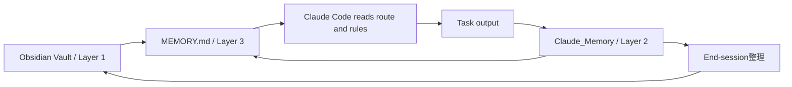

# Candidate Distillation: Obsidian + Claude Code Three-Layer Memory

## Boundary

This note is provisional orientation.

It distills a Bilibili tutorial into VAKS candidate design references. It is not
reviewed knowledge, not a decision, not a formal pattern, and not action basis.

## 一句话

这条视频是强 P1，但它的强点不是“新架构”，而是把 VAKS 已经在做的事讲成了一个普通人能马上上手的三层脚手架：

```text
长期知识层 -> 会话记忆层 -> 根目录路由文件
```

翻译成 VAKS 语言：

```text
reviewed/candidate/raw 分层要稳；
会话产物先隔离；
启动入口先告诉 agent 去哪里读、按什么边界工作；
结束时再决定哪些东西进入长期资料库。
```

## 参考层标签

Canonical tag:

```yaml
reference_layer_tag: ref/three-layer-memory-router
label_zh: 三层记忆路由脚手架
tag_scope: reference_layer
default_retrieval: false
retrieval_policy: activation_only
truth_boundary: activation_not_truth
borrow_level: P1-UX / P1-ops / P2-onboarding
```

说明：

```text
这不是新增 VAKS 主架构层。
它只是一个参考层标签，用来标记“本地 vault + 会话 scratch + root router file”这种可借鉴操作模型。
```

## 这条视频解决什么问题

用户痛点：

```text
AI 每次新会话都失忆：项目背景、风格偏好、历史脚本、上次决策、未完成思路都要重讲。
```

视频方案：

```text
用 Obsidian 保存长期知识；
用 Claude_Memory 保存当前会话的中间产物；
用 MEMORY.md 告诉 Claude Code 启动时先读什么、怎么读、如何写回。
```

## 核心工作流



人话：

```text
先读地图，再干活；先写草稿，再整理；先隔离会话产物，再进入长期知识。
```

## Candidate Points

### 1. `three_layer_memory_scaffold`

候选结论：

```text
Agent-facing vault memory should separate stable knowledge, session scratch, and routing/index instructions.
```

VAKS 对应：

- stable knowledge: reviewed/candidate/raw vault content, but authority levels must stay separate.
- session scratch: temporary project/workbench/codex run notes.
- router: `AGENTS.md`, latest handoff, `DEV_CONTEXT.md`, possible future `MEMORY.md`.

边界：

```text
三层是 UX/ops scaffold，不是 truth hierarchy。
```

### 2. `memory_router_file`

候选结论：

```text
A root router file should tell the agent identity, folder map, read order, rules, and output expectations.
```

VAKS 已有相似物：

- `AGENTS.md`: local operating rules.
- `00_handoff/`: recovery state and next-window entry.
- `DEV_CONTEXT.md`: current workbench context.
- `MEMORY_TIER.md`: activation tier semantics.

可改进点：

```text
把这些入口对非开发者讲成“一张启动地图”，会比直接讲 schema 更好。
```

### 3. `session_memory_quarantine`

候选结论：

```text
Session outputs should first land in a quarantined session-memory space, not directly in the durable knowledge layer.
```

VAKS 价值：

- 防止 AI 摘要直接污染长期知识。
- 保留思路、草稿、决策过程，但先作为 candidate / workbench trace。
- 允许 closeout 后再按 raw/candidate/reviewed 路线处理。

### 4. `end_session_promotion_ritual`

候选结论：

```text
Every useful agent session needs a closeout ritual that decides what to archive, route, promote, or discard.
```

VAKS 对应：

- handoff update
- candidate distillation
- review queue routing
- source card retention
- feedback event when the session reveals a failure

关键边界：

```text
promotion ritual is not automatic promotion to truth.
```

### 5. `five_prompt_smoke_tests`

候选结论：

```text
Read, analyze, write, connect, archive can serve as smoke tests for whether an agent-memory scaffold actually works.
```

VAKS 可用测试：

- read: can the agent find the right local rules and source cards?
- analyze: can it summarize without crossing authority layers?
- write: can it draft into the right candidate/raw location?
- connect: can it activate related context without creating false relations?
- archive: can it produce a clean closeout and leave recovery state?

### 6. `claude_md_vs_memory_md_split`

候选结论：

```text
General behavior rules and vault-specific route/index rules should be separated.
```

VAKS 解释：

- General agent behavior: tone, safety, broad conventions.
- Project-local route: paths, current handoff, active rules, source folders, review boundaries.

这能防止“全局习惯”和“本库规则”互相污染。

## 反漏提取

```text
pain point:
  - cross-session memory loss and repeated context setup.

workflow:
  - local vault -> stable folders -> session folder -> MEMORY.md router -> agent work -> session writeback -> closeout migration.

tools/plugins:
  - Obsidian, Claude Code, possible terminal plugin, possible CLI/model switcher, Smart Connections as future semantic layer.

information structure:
  - long-term folders, session folder, root router file, prompt templates.

judgment mechanism:
  - manual end-session整理 decides what moves from session memory to long-term memory.
  - no reviewed-evidence mechanism in the video.

user experience:
  - much simpler than VAKS terminology; strong as onboarding metaphor.

automation boundary:
  - context loading can be automated; knowledge promotion must remain gated.

risk:
  - session summaries may become false memory.
  - root router may be overtrusted.
  - whole-vault scans may leak or overload.
  - folder taxonomy may be copied as schema.

fit for us:
  - strong reference for memory tier, dev context, agent entrypoint, and closeout.

challenge to us:
  - VAKS needs a simpler operator ritual, not only architecture docs.
```

## VAKS 层级归位

```text
Capture:
  - local-first Obsidian vault and source retention.

Understand:
  - agent reads stable folders and summarizes/synthesizes into candidate outputs.

Review:
  - absent in the video; VAKS must preserve evidence-aware review before promotion.

Connect:
  - related-note search and knowledge-map output are useful, but only as activation.

Activation / Context Pack:
  - MEMORY.md is the key reference: a root activation router.

Decision / Action:
  - no direct action-basis support.

Use Ledger / Feedback:
  - session memory and closeout can become feedback/use-ledger input, not truth mutation.
```

## 可借鉴

### P1

- Root router file: one file that tells the agent who/where/how/what-first.
- Session scratch quarantine: outputs do not immediately enter long-term memory.
- Closeout ritual: end every meaningful session by archiving/routing/promoting.
- Five workflow smoke tests: read, analyze, write, connect, archive.

### P2

- Creator-facing folder examples as onboarding language.
- Quick prompt templates for recurring workflows.
- Split general agent behavior file from vault-specific memory router.

### P3

- Smart Connections or semantic graph plugins as later activation helpers.
- Whole-vault semantic search as a support layer only.

## 不能借鉴

- Do not treat `MEMORY.md` as truth, evidence, review, or action basis.
- Do not let `Claude_Memory` / session scratch directly mutate Layer 1.
- Do not copy `Context / Script / Reading / Daily` as VAKS schema.
- Do not scan the full vault by default for every ordinary question.
- Do not let an AI-written session summary replace raw source anchors.
- Do not let creator productivity framing weaken VAKS promotion gates.

## 与我们现有 VAKS 的关系

这条视频不是在告诉我们“缺一个主层级”。我们已经有更强的内部逻辑：

```text
Capture -> Understand -> Review -> Connect -> Act and Learn
raw / candidate / reviewed
Activation Tier is not truth tier
Feedback is not truth mutation
```

它真正提醒的是：

```text
把复杂边界做成一个很朴素的启动/会话/收尾仪式。
```

换句话说，VAKS 的内核比视频强，但视频的“上手表面”更轻。

## 最小吸收建议

不要改主架构。

把它作为 VAKS 的参考层/UX 参考保留：

```text
ref/three-layer-memory-router
```

未来如果要落地，可以只做一个最小操作面：

```text
1. Start: read AGENTS.md + latest handoff + DEV_CONTEXT.
2. Work: write temporary session notes into a quarantined scratch/workbench.
3. Close: summarize, route, and only then create source/candidate/review artifacts.
```

## 是否建议进入 REVIEW_QUEUE

暂不建议进入正式 REVIEW_QUEUE。

原因：

```text
它验证的是 UX/操作脚手架，不是证据型知识点。
```

进入 REVIEW_QUEUE 的触发条件：

- VAKS 要设计 agent writeback 权限。
- VAKS 要正式设计 session scratch / closeout workflow。
- VAKS 要发布面向普通用户的 `MEMORY.md` / `AGENTS.md` 模板。

## Forbidden

```text
project_borrow_scope in this candidate note
decision outcome
formal pattern
action basis
truth confidence
```
