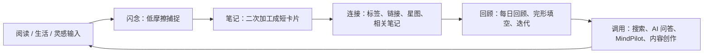

# reminds 产品设计学习拆解

日期：2026-06-14  
对象：https://reminds-app.com/  
用途：公开资料学习参考；不复制代码和素材；不安装、不运行、不反编译 App；不调用登录、付费、私有 API。

## 边界

本次只保存和分析官网公开内容：

- 官网首页 HTML、robots、sitemap、llms.txt。
- 官网明确提供的公开 Markdown 页面：`/`、`/membership`、`/mindpilot`、`/zettelkasten`、`/reism`、`/doc`、`我们对产品的思考`、`快速入门`。
- 首页公开引用的同源 `/assets/` 静态资源，主要用于确认路由、页面结构和文案来源。
- 官网公开下载入口里的 App 包可用性探测，以及 Android APK 包下载留档。

没有登录，没有读取账号内容，没有使用 API key。公开前端包里能看到文档加载逻辑，但本次没有调用它的文章 API，也没有使用前端里暴露的 token。

App 包处理边界：

- Windows 官方公开链接 `https://dl.reminds-app.com/release/win/x64/reminds-win-x64-2.4.0-beta.zip` 当前对 GET Range 返回 404，未能下载。
- Android 官方公开 APK 已下载：`downloads/reminds-release-1.5.0-132.apk`，大小 `60644303` 字节，SHA256 `7925F7BE46CDB8078E2B70BD36064F748AE3716D6A08541E34FF3BC9A21DE2C7`。
- Mac arm64 / x64 官方公开 DMG 链接可访问，大小约 `258947068` / `270091647` 字节；本轮只记录可用性和大小，未下载，避免无必要的大文件。
- APK 只做下载、哈希、ZIP 文件名清单和顶层目录计数；未安装、未运行、未反编译、未绕过权限。

沙盒文件：

- `reminds-app.com_`
- `reminds-app.com_llms.txt`
- `reminds-app.com_robots.txt`
- `reminds-app.com_sitemap.xml`
- `page_home.md`
- `page_membership.md`
- `page_mindpilot.md`
- `page_zettelkasten.md`
- `page_reism.md`
- `page_doc.md`
- `page_doc_product_philosophy.md`
- `page_doc_quick_start.md`
- `asset-urls.txt`
- `asset-urls-recursive.txt`
- `asset-download-manifest.json`
- `asset-recursive-manifest.json`
- `assets/`
- `downloads/public-package-probes.json`
- `downloads/reminds-release-1.5.0-132.apk`
- `downloads/reminds-release-1.5.0-132.apk.sha256.json`
- `downloads/reminds-release-1.5.0-132.apk-entries.json`
- `downloads/reminds-release-1.5.0-132.apk-top-level-counts.json`

递归资产扫描只限制在 `https://reminds-app.com/assets/` 下。正则从压缩 JS 里误抓了 6 个动态表达式为资源 URL，返回 404，属于假阳性，不影响产品逻辑分析。

## 一句话结论

reminds 的本质不是“AI 聊天 + 笔记”，而是一个围绕个人成长的卡片笔记闭环：轻记录、强连接、可回顾、可调用，再用 AI 降低整理、发现和输出的摩擦。

它比普通笔记 App 强的地方在产品取舍：它公开承认自己只做个人、短卡片、基于用户笔记的可靠 AI。这个能力圈表达非常值得 VAKS 学。

但它不是 VAKS 的替代方案。reminds 解决的是个人认知成长和内容再利用；VAKS 解决的是来源、证据、候选、审查、关系、行动依据的可信闭环。VAKS 在“能不能作为行动依据”上更强，reminds 在“普通人愿不愿意天天用”上更成熟。

## 产品设计逻辑反推

### 1. 定位

reminds 把自己定位成面向终身学习者的 AI 卡片笔记。它不是协作文档、不是长文编辑器，也不是通用知识库。

它的目标用户不是“管理所有知识的人”，而是这些人：

- 深度阅读者：读书、摘录、理解。
- 好学者：为长期成长积累材料。
- 灵感捕捉者：随时记录闪念。
- 生活/情绪记录者：把个人经验沉淀下来。
- 决策者：希望第二大脑能辅助解决问题。
- 内容创作者：从已有笔记生成文章、复盘、计划。

所以它的产品逻辑不是企业知识管理，而是个人成长飞轮。

### 2. 核心飞轮



它把“记录”拆成两个入口：

- 闪念：临时、轻、快，不加工会过期，避免知识垃圾堆积。
- 笔记：长期、正式、可迭代，进入个人知识网络。

这个拆法很聪明，因为它降低了记录心理压力，又保留了后续整理入口。

### 3. 功能分层

| 层 | reminds 的设计 | 背后目的 |
| --- | --- | --- |
| 捕捉层 | 闪念、图文、语音、微信读书同步 | 把输入阻力降到最低 |
| 加工层 | 高级 Markdown 编辑、标题生成、校对 | 把粗糙输入变成可复用卡片 |
| 连接层 | 标签、双链、全局星图、局部星图、相关笔记 | 让卡片形成网络，而不是孤岛 |
| 记忆层 | 每日回顾、完形填空、答案揭示、迭代 | 用适度摩擦增强长期记忆 |
| 调用层 | 关键词搜索、AI 问答、MindPilot 项目、无限画布 | 从知识网络里提取结果 |
| 数据层 | 本地优先、同步、Markdown 导出、第三方云备份 | 降低用户对锁定和丢失的担心 |
| 生态层 | MCP、llms.txt、公开 Markdown 页面 | 让 AI 客户端和搜索入口更容易理解它 |

### 4. AI 的产品位置

reminds 的 AI 不是独立 chatbot，而是嵌在笔记循环里的“摩擦降低器”和“关联发现器”。

它公开展示的 AI 能力主要是：

- 给笔记生成标题。
- 校对笔记。
- 推荐相关笔记。
- 做主题聚合。
- 生成每日回顾。
- 基于笔记问答。
- 在 MindPilot 里把笔记变成复盘、计划、创作材料。

更关键的是，它把“不回答”包装成可靠性的体现：如果笔记里没有内容，AI 可以给不出答案。这点比很多产品“硬编一个答案”高级。

### 5. 商业化逻辑

免费层保留基础可用：

- 无限图文笔记/闪念。
- 多设备同步。
- Markdown 导出。
- 基础编辑器。
- 少量 AI 问答和标题能力。

会员层卖的是“成长飞轮加速”：

- 无限 AI 调用。
- 无限 MindPilot 项目。
- 无限星图节点。
- 每日回顾。
- 相关笔记推荐。
- 主题涌现。
- 语音笔记。
- 微信读书高级同步。
- 高级分享模板和备份。

这说明它的商业重点不是卖存储，而是卖“更频繁、更智能、更顺滑的个人成长循环”。

### 6. 信息架构

官网导航不是单纯功能菜单，而是三套叙事叠在一起：

- 产品能力：MindPilot、会员、探索。
- 方法论教育：卡片笔记法、reminds 第一课。
- 品牌文化：re.ism、品牌故事、社区。

这套组合的目的很清楚：先卖愿景，再教方法，再卖工具，最后用社区/内容让用户持续认同。

## 和 VAKS 的关键区别

| 维度 | reminds | VAKS |
| --- | --- | --- |
| 根目标 | 帮个人成长、记忆、思考、创作 | 把资料变成可审查、可连接、可行动的知识 |
| 原子单位 | 短卡片笔记 | candidate point / evidence item / reviewed claim / relation |
| AI 角色 | 提升体验、推荐关联、辅助生成 | 激活上下文、提取候选、辅助审查，但不能直接改真值 |
| 连接含义 | 认知联想、双链、星图 | reviewed relation 与 activation relation 必须分开 |
| 回顾含义 | 记忆强化 | review_due / evidence sufficiency / applicability check |
| 可信边界 | 基于用户笔记，缺内容不答 | source-backed、evidence-aware、candidate vs reviewed 分层 |
| 产品风格 | 个人消费级第二大脑 | 研究/架构/行动依据系统 |
| 强项 | 轻、顺、可天天用 | 边界硬、证据强、抗幻觉、能承接复杂资料 |

说人话：reminds 是“让你愿意不断写、不断回头看、不断用起来”的好产品；VAKS 是“把信息变成能不能信、能不能用、凭什么用”的系统。两者不是同一战场。

## VAKS 可以借鉴什么

### 立即值得吸收

1. 能力圈公开化  
   reminds 明确说自己不做协作、不做长文、只做短卡片、只基于笔记做可靠 AI。VAKS 也应该有一份产品化的“能力圈说明”：不是什么资料都自动成真，不是什么插件输出都进 reviewed，不是什么检索结果都能当行动依据。

2. “缺证据就不答”的用户体验  
   VAKS 已经有 evidence sufficiency gate，但产品表达可以更像用户语言：当前资料不足以支持这个结论，我能给候选理解，但不能给行动建议。

3. 闪念 / 笔记分层思路  
   对 VAKS 来说，可以对应为：
   - quick capture：原始输入、想法、链接、临时材料。
   - candidate point：整理后的候选点。
   - reviewed claim / relation：审查后的可用知识。
   这个不是新架构，是把现有层级变成用户更容易理解的入口。

4. 多端分工表达  
   reminds 的移动端捕捉、桌面端整理很清楚。VAKS 未来产品化也可以这么拆：手机/轻入口负责 capture，桌面/工作台负责 review、context pack、decision/action basis。

5. MCP 入口设计  
   reminds-mcp 的工具面很克制：创建闪念、获取闪念、搜索笔记、批量获取笔记。VAKS 未来也可以做一个极薄 MCP，但必须有隔离：
   - `create_candidate_input`
   - `search_context`
   - `get_evidence_packet`
   - `get_context_pack`
   - `append_feedback_event`
   不能开放“直接写 reviewed truth”。

6. llms.txt 和 `?format=md`  
   这个很值得借鉴。VAKS 如果未来有产品/文档站，可以给 LLM 一个干净入口：项目结构、边界、公开文档 Markdown、MCP 工具说明、不能做什么。

7. “记、连、忆、用”的产品话术  
   VAKS 可以转译成更硬一点的版本：
   - 捕捉：Capture / Provenance
   - 理解：Candidate Comprehension
   - 审查：Review / Calibration
   - 连接：Reviewed Relation / Activation
   - 调用：Context Pack / Action Basis
   - 反馈：Use Ledger / Feedback

### 可以借鉴但要改造

1. 星图  
   reminds 的星图是认知结构可视化。VAKS 可以借鉴可视化，但必须分颜色/层：
   - candidate relation
   - reviewed relation
   - activation-only association
   - challenge / contradiction
   - stale / review_due
   不能让图看起来像“所有线都可信”。

2. 主题聚合  
   对 reminds，主题涌现是灵感功能；对 VAKS，它只能生成 synthesis_needed 或 candidate cluster，不能自动变成 pattern 或 reviewed relation。

3. 每日回顾  
   VAKS 可以做“review due / activation refresh”，但不是背单词式回顾。VAKS 的回顾重点是：过期了吗、证据够吗、适用范围变了吗、有没有反证。

4. 内容创作  
   reminds 把笔记变成文章。VAKS 可以输出报告、方案、决策包，但输出必须带 evidence packet / scope / risk / unknowns。

### 不该借鉴

1. 不要把短卡片限制套到所有 VAKS 资料上  
   VAKS 的 source、evidence packet、review note 有时必须长。短只适合 candidate point，不适合证据材料本体。

2. 不要把 AI 推荐的关联当 reviewed relation  
   reminds 可以把推荐当体验；VAKS 不能把推荐当事实关系。

3. 不要把漂亮星图当知识可信度  
   图只是激活和导航，不是证据。

4. 不要把回顾次数当可信度  
   记住了不等于是真的，也不等于适用于当前行动。

5. 不要做消费级全功能笔记 App  
   VAKS 的价值在“证据、边界、审查、行动依据”，不是和 Obsidian / Notion / reminds 抢通用笔记入口。

## 对 VAKS 的补强方案

这不是改现有架构，而是产品化补层，优先级如下。

### P0：能力圈页

新增一份面向用户的能力圈说明，内容包括：

- VAKS 能做：资料留痕、候选提取、证据审查、关系连接、上下文包、行动依据、反馈回路。
- VAKS 不做：插件输出直接成真、检索结果直接成 reviewed、AI 自动改真值、漂亮图谱替代证据、所有资料全量重审。
- VAKS 的承诺：缺证据时会说不够，证据冲突时会暴露冲突，适用范围不明时不会硬给行动结论。

### P1：轻入口分层

把现有 Capture / Candidate / Reviewed 用更普通的产品语言包装：

- 临时输入：随手丢资料、链接、想法。
- 候选点：系统整理出来的可审查单位。
- 证据包：重要点进入行动前必须携带的依据。
- 已审知识：经过 review 的 claim / pattern / relation。

不需要改主架构，只是给未来界面和文档一个低摩擦入口。

### P1：MCP 最小工具面

借鉴 reminds-mcp，但 VAKS 必须更严格：

| 工具 | 允许做什么 | 禁止做什么 |
| --- | --- | --- |
| `create_candidate_input` | 写入 candidate / raw inbox | 不能写 reviewed |
| `search_context` | 返回候选和 reviewed 混合结果并标层 | 不能把检索排名当可信度 |
| `get_evidence_packet` | 获取某点的证据包 | 不能自动补证据 |
| `get_context_pack` | 生成 action 前上下文包 | 不能跳过 sufficiency gate |
| `append_feedback_event` | 记录使用反馈 | 不能直接改 truth confidence |

### P1：LLM 公开入口

未来如果 VAKS 有文档站，做一个 `llms.txt` 风格入口：

- 当前架构边界。
- 什么是 candidate / reviewed / activation / feedback。
- 哪些文档能被 LLM 读取。
- 哪些内容不能被当成 truth。
- MCP 工具清单和权限边界。

### P2：可视化但分层

VAKS 可以有“知识星图”，但必须反 reminds 式误导：

- 默认显示“为什么激活”，不是“这就是真的”。
- 每条边必须显示类型：reviewed、candidate、activation-only、challenge、superseded。
- 行动模式下只允许 reviewed / evidence-backed 边进入主视图。

### P2：回顾升级为 Review Due

把 reminds 的每日回顾思路改造成 VAKS 的审查提醒：

- 过期回顾：时间、版本、环境是否变了。
- 反证回顾：是否出现 counterevidence。
- 使用回顾：之前的 action basis 实际效果如何。
- 置信上限回顾：原文没读全、证据不足、ASR 不清等导致的 confidence cap 是否解除。

## 评分

| 维度 | 分数 | 判断 |
| --- | --- | --- |
| 产品定位 | 9/10 | 能力圈清楚，知道不做什么 |
| AI 边界表达 | 8/10 | 基于笔记才回答，这点很健康 |
| VAKS 产品化借鉴价值 | 8/10 | 能力圈、轻入口、MCP、llms.txt 都值得吸收 |
| VAKS 底层架构替代价值 | 2/10 | 它不是 evidence/review/action-basis 系统 |
| 直接照搬风险 | 高 | 容易把 VAKS 带偏成普通第二大脑 |

## 最终判断

reminds 值得 VAKS 借鉴的不是“卡片笔记”本身，而是它把产品边界讲清楚、把 AI 放进工作流、把用户每天愿意用的摩擦处理得很好。

VAKS 比它强的地方是：我们不是只帮助用户想起来、连起来、写出来；我们还要回答“这个点凭什么成立、证据够不够、现在适不适用、能不能作为行动依据”。

所以正确吸收方式是：

```text
借鉴它的产品表达和入口设计
保留 VAKS 的证据分层和审查边界
把 AI 做成候选/激活/辅助审查工具
绝不让 AI 推荐、星图、回顾次数替代 reviewed knowledge
```

## APK 沙盒补充：移动端产品面反推

本节基于公开 Android APK 包做产品学习拆解。边界仍然是：只看包结构、Manifest 字符串、Capacitor 配置、资源文件名、onboarding 图和公开前端模块名；不安装、不运行、不反编译业务代码、不调用接口。

### APK 形态

APK 基本信息：

- 文件：`downloads/reminds-release-1.5.0-132.apk`
- 版本线索：`versionName=1.5.0`
- 包名：`ai.reminds.mobile`
- 体积：`60644303` 字节
- SHA256：`7925F7BE46CDB8078E2B70BD36064F748AE3716D6A08541E34FF3BC9A21DE2C7`
- 条目数：`1141`

顶层结构：

| 区域 | 观察 |
| --- | --- |
| `assets/public/` | 内置前端应用资源，约 440 个条目 |
| `assets/capacitor.config.json` | Capacitor 配置，说明是 Web 前端 + 原生能力桥路线 |
| `assets/capacitor.plugins.json` | 原生插件清单 |
| `res/` | Android 资源，约 592 个条目 |
| `lib/` | Native 库，主要是 Bugly 和 SQLCipher |
| `classes.dex` | Android 壳层和插件运行代码 |

这说明移动端不是“纯原生重写”，而是：

```text
Vue / Quasar 前端
-> Capacitor WebView 壳
-> 原生插件补系统能力
-> SQLite / 文件系统 / 通知 / 分享 / 语音 / 微信 / 小组件
```

这个路线很适合快速做多端一致体验：产品主逻辑放前端复用，真正需要手机能力的地方才接原生桥。

### 原生能力桥

`capacitor.config.json` 和插件清单显示的能力：

- SQLite：本地数据库，配置中 `androidIsEncryption=false`。
- Camera：相机、相册。
- Filesystem：外部存储读写。
- VoiceRecorder：录音。
- SpeechRecognition：语音识别。
- Wechat：微信登录/分享/生态入口。
- LocalNotifications：本地通知。
- Clipboard：剪贴板。
- Share：系统分享。
- Device / Network / Preferences：设备、网络、偏好设置。
- Haptics / Keyboard / StatusBar / SplashScreen：移动端体验细节。
- Widget Bridge / Widget Image Store：桌面小组件。
- Billing / Subscriptions：订阅和会员。
- Bugly：崩溃/质量监控。

Manifest 字符串能看到的高层组件：

- `ai.reminds.mobile.MainActivity`
- `ai.reminds.mobile.wxapi.WXEntryActivity`
- `ai.reminds.mobile.fileprovider`
- `FleetingWidgetProvider`
- `PinnedMemoWidgetProvider`
- `ImageWidgetProvider`
- `CameraWidgetProvider`
- Local Notification restore / dismiss / timed publisher
- Billing activity
- Share intents：`SEND` / `SEND_MULTIPLE`
- Deep link：`VIEW` + `BROWSABLE`

这不是简单 WebView。它把“移动端随手记录”做到系统层：分享菜单、小组件、相机、图片、语音、通知、微信、离线缓存。

### 前端页面面

APK 内置前端资源显示的核心页面/模块：

- `LoginLayout`
- `FleetingPage`
- `MemoPage`
- `MemoEditOverlay`
- `MemoCard`
- `ReviewPage`
- `MindPilotPage`
- `ProfilePage`
- `MemoShare`
- `MemoViewer`
- `TagSelector`
- `SpeakOverlay`
- `voice-recording-service`
- `audio-compression-service`
- `clipboard-service`
- `data-sync-service`
- `notification-store`
- `sync-store`
- `tag-store`
- `mindpilot-store`

这进一步确认了真实移动端主路径：

```text
登录
-> 闪念捕捉
-> 笔记整理 / 编辑 / 标签
-> 每日回顾
-> MindPilot 调用
-> 分享 / 查看 / 个人中心
```

公开前端资源里能看到的接口路径名包括：

- `/v1/user/login`
- `/v1/wechat/login`
- `/v1/sms`
- `/v1/user/token`
- `/v1/user/presigned-url`
- `/v1/fleeting/summary`
- `/v1/fleeting/voice-processing`
- `/v1/memo/title`
- `/v1/memo/voice-processing`
- `/v1/mindpilot-v2/recommend_questions`
- `/v1/mindpilot-v2/like`
- `/v1/mindpilot-v2/dislike`
- `/v1/subscription`
- `/v1/subscription/plans`
- `/v1/appstore/verify`
- `/v1/statistics/event`

这些接口本轮只记录名称，没有调用。产品上能推出来：它把语音处理、标题生成、闪念摘要、MindPilot 推荐问题、订阅、统计事件都做成后端服务，移动端负责低摩擦入口和本地体验。

### 同步策略线索

`data-sync-service` 里能看到同步任务有优先级：

- `Critical`
- `FastLoad`
- `Normal`
- `Background`

任务名包括：

- `preference`
- `fleeting-quick`
- `tag`
- `memo-quick`
- `fleeting-full`
- `memo-full`
- `attachment-full`
- `review`
- `link`
- `agent-info`
- `mindpilot-v2`
- `notification-full`

这套同步设计很值得 VAKS 借鉴。它不是“所有东西一起同步”，而是：

```text
先保证能启动和能看到关键内容
再补快速列表
再补完整数据
最后补附件、回顾、链接、AI Agent、通知
```

对 VAKS 来说，可以翻译成：

```text
Critical：当前用户意图、raw/candidate 输入落盘、最小索引
FastLoad：最近 hot context、最近 candidate、待审队列摘要
Normal：完整 source/card/relation 同步
Background：附件、长文、低频索引、历史反馈、冷资料
```

这样既保留本地优先，又不会让用户一打开就等全库。

### Onboarding 叙事

APK 内置 6 张 onboarding 图，本轮只用于观察产品入口逻辑：

1. 多端入口：移动端、桌面闪念小窗、微信读书、微信服务号。
2. 闪念捕捉：文本、图片、语音、链接都能快速进入。
3. 正式笔记：Markdown、公式、标题层级、引用等结构化表达。
4. 每日回顾：遗忘曲线、填空、统计反馈。
5. MindPilot：基于笔记资料问答/推理，展示接入 DeepSeek。
6. 数据主权：本地优先、全平台同步、Markdown 导出。

这个 onboarding 顺序很清楚：

```text
入口很多
-> 先随手记
-> 再整理成笔记
-> 再回顾巩固
-> 再用 AI 调用
-> 最后强调数据可控
```

它没有一开始讲复杂知识管理，而是先告诉用户“你怎么开始用”。这是 VAKS 产品化最该学的一点。

### VAKS 可借鉴点

1. 移动端只做轻入口，不承载真值审查  
   VAKS 如果做移动端，最适合从 raw / candidate capture 开始：文字、语音、图片、链接、分享菜单、小组件。不要在手机上强迫用户做完整证据审查。

2. Hybrid 壳路线可行  
   VAKS 未来不一定要一开始写原生 App。可以用 Web / PWA / Capacitor 先做统一前端，再按需接文件、通知、分享、语音、离线数据库。

3. 本地优先 + 分级同步  
   reminds 的同步任务优先级非常适合借鉴。VAKS 可以把“先可用，再完整”做成产品原则。

4. 小组件/分享菜单是捕捉利器  
   对 VAKS 来说，系统分享入口可以把网页、PDF、截图、语音想法直接进 raw inbox。小组件可以做“快速候选输入”。

5. Onboarding 应该讲工作流，不讲 schema  
   VAKS 第一次打开不该先讲 `Source / Claim / Relation`，而应该讲：
   - 丢资料进来
   - 系统整理候选点
   - 重要点会要求证据
   - 用之前生成上下文包
   - 用完反馈进入 ledger

6. 语音是高价值入口  
   reminds 把录音、语音识别、音频压缩都作为移动端能力。VAKS 也可以把“口述想法 -> candidate input”作为轻入口，但 ASR 结果只能是 raw/candidate，不能直接成 reviewed。

7. 数据主权要放到首屏教育  
   本地优先、同步、导出不是技术细节，是用户信任入口。VAKS 也应该把“资料归你、可导出、可审计”讲明白。

### VAKS 不应照搬

1. SQLite 不加密不能照搬到 VAKS 敏感资料  
   reminds 配置里 Android SQLite encryption 为 false。对普通消费笔记可能是产品取舍；VAKS 如果承载敏感资料，至少要把加密、权限、导出边界作为独立设计题。

2. AI 问答不能只靠“基于笔记”  
   reminds 的可靠边界是“没有笔记就不答”。VAKS 还要再加：有没有证据、是否 reviewed、是否过期、是否适用于当前行动。

3. 会员/统计/分享模板不是 VAKS 现阶段重点  
   这些是消费产品增长和商业化能力。VAKS 当前优先级仍然是 capture、candidate、review、activation、context pack、feedback。

4. 小组件不能直接写入 reviewed knowledge  
   移动快捷入口只能进 raw / candidate / feedback event，不能绕过 review queue。

### 移动端补强方案

如果把这轮学习转成 VAKS 产品化路线，建议只做薄层升级：

```text
P0：移动/桌面轻捕捉入口
  - 文本、语音、图片、链接、分享菜单
  - 全部进入 raw inbox / candidate input
  - 本地先落盘，后台同步

P1：分级同步队列
  - Critical：当前输入和最小索引
  - FastLoad：最近资料、热上下文、待审摘要
  - Normal：完整 source / candidate / reviewed relation
  - Background：附件、历史反馈、冷索引

P1：产品化 onboarding
  - 捕捉 -> 候选 -> 证据 -> 上下文包 -> 行动 -> 反馈
  - 用普通语言讲能力圈

P2：系统级入口
  - 分享菜单接收网页/PDF/图片
  - 桌面/手机小组件做 quick capture
  - 通知只提醒 review_due，不改变真值
```

一句话：reminds 的移动端厉害在“低摩擦入口 + 本地可用 + 同步分层 + AI 调用”。VAKS 应该借入口和同步，不借消费化真值观。
