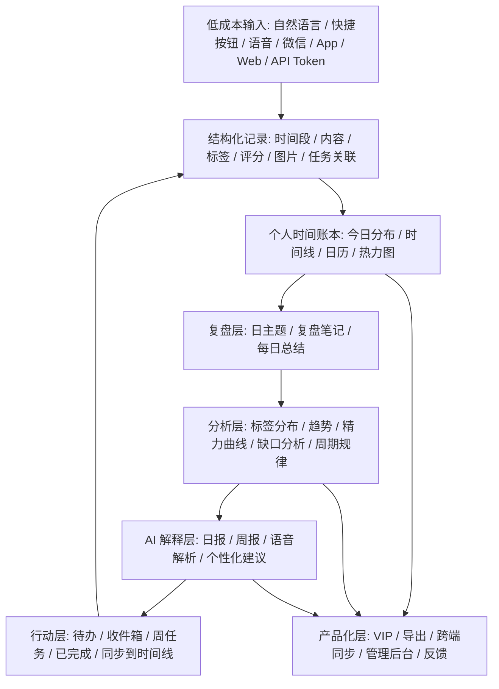

# TimeFriend / Timarkin 沙盒反推调研

## 先说人话

TimeFriend / 替码 Timarkin 不是一个知识库产品，它是一个“时间块记录 + 标签 + 时间线 + 统计分析 + AI 解释 + 待办闭环”的个人时间管理产品。

它厉害的地方不是知识真伪、证据审查、行动可靠性，而是把“每天几秒钟记录”做成了一个很顺的产品闭环：

```text
快速记录
-> 自动/手动结构化
-> 时间线和日历回看
-> 统计图表反馈
-> AI 做解释和总结
-> 待办/复盘/导出继续循环
```

VAKS 比它强的地方很明确：VAKS 有 candidate / reviewed / truth / action basis 的边界，有证据支持检查、适用性检查、反馈不改真相这些底层纪律。TimeFriend 没有这套“可信知识到行动”的骨架。

但 TimeFriend 很值得借鉴它的产品化手感：低成本 capture、时间线 workbench、热力图、标签视图、AI 作为解释层、导出包、跨端入口。这些适合补 VAKS 的产品层，不适合搬进 VAKS 的 truth 层。

## 已补进本调研的项目边界

本次调研按用户最新边界执行：

- 只写入本沙盒目录：`outputs/review/2026-06-14-timefriend-sandbox-study/`
- 不改 VAKS 现有架构文件。
- 不同步 Obsidian。
- 不把本调研结论当 reviewed knowledge。
- 只看公开网页、公开前端包、公开 App Store 信息、公开截图。
- 不登录、不调用私有接口、不绕权限、不运行或逆向私有后端。
- 飞书外链只做公开访问探测；抓到登录壳，不读取账号态内容。

## 已抓取材料

| 类别 | 结果 | 本地证据 |
|---|---|---|
| 首页 HTML | 成功 | `timefriend.xin_home.html` |
| `llms.txt` | 返回首页 HTML，不是真正 LLM manifest | `timefriend.xin_llms.txt` |
| `robots.txt` / `sitemap.xml` | 多次超时，未形成站点地图证据 | `public-page-fetch-manifest.json` |
| 主 JS / CSS | 成功，JS 用 range 重建完整包 | `assets/index-DGxeQ1mx.full.js`, `assets/index-cgtDKvxs.css` |
| 懒加载页面资源 | 52 个页面/模块资源完成下载并记录哈希 | `vite-asset-download-manifest.json` |
| 隐私政策 | 成功 | `privacy.html`, `privacy-text-sections.txt` |
| 服务协议 | 公开 URL 返回 GitHub Pages 404 | `terms.html` |
| App Store 页 | 成功 | `appstore-timefriends.html`, `appstore-target-app-summary.json` |
| App Store 截图 | 6 张公开截图成功下载 | `appstore-screenshots/`, `appstore-screenshot-download-manifest.json` |
| 飞书外链 | 抓到登录壳，不是公开文档正文 | `feishu-doc-public-probe.html` |

## 公开身份和定位

首页 SEO 给出的定位：

- 标题：`替码Timarkin - 智能时间管理与记录工具`
- 描述：智能时间管理工具，记录时间、分析时间分配、养成习惯，支持自然语言输入、AI 智能分析、多维度数据可视化。
- 关键词包含：时间管理、时间记录、Timarkin、替码、替码印记、时迹、TimeFriend、日程管理、时间复盘、习惯养成、时间追踪、效率工具。

App Store 公开页给出的定位：

- App 名：`替码印记`
- 副标题：智能时间记录与分析
- 类别：效率
- 价格：免费
- 设备：iPhone / iPad
- 系统要求：iOS 16.0 或更高版本
- 评分：4.8，9 个评分
- 开发者：扬 马
- 公开描述里的核心功能：智能时间记录、自定义标签、图片、历史记录编辑、时间轴、GitHub 风格活跃度图表、多维统计、时间趋势洞察、AI 时间报告、智能推荐标签、每日回顾、云端同步、加密存储、邮箱登录。

隐私政策给出的产品和数据边界：

- 最近更新：2026-05-13
- 数据托管：阿里云服务器
- 声明不出售个人信息、不接入广告 SDK
- 数据类型包括账号基础信息、时间记录/标签/偏好设置、客户端信息、网络请求日志
- 支付通过微信支付或支付宝完成，产品只接收支付结果用于开通会员权益

## 前端和公开接口结构

站点是一个 Vite/Vue 单页应用。公开路由里可以看出它已经不是简单 landing page，而是完整 Web App：

```text
/
/app
/timeline
/analytics
/insights
/gap-analysis
/pattern-analysis
/diary
/help
/settings
/tags
/subscription
/subscription/success
/login
/wechat-bind
/reset-password
/verify-email
/todo
/inbox
/week
/todo-calendar
/completed-tasks
/todo-history
/admin/login
/admin/dashboard
```

公开前端包里暴露的 API 类别：

- 账号：邮箱验证码、密码登录、注册、重置密码、头像、微信绑定、注销账号。
- 时间记录：`/records`、批量记录、搜索、统计、标签。
- AI：每日总结、语音复盘整理、记录健康检查、日历对比等。
- 待办：todo / inbox / calendar / history / completed task。
- 标签：用户标签、标签颜色、多级标签、重命名。
- 导出：Markdown / Word / PDF / ZIP 等导出能力。
- 订阅/VIP：会员权益、支付成功页、免费额度限制。
- 管理后台：用户增长、订单、收入、反馈、价格、存储排行等。

这说明它的完整产品逻辑是“时间数据平台”，不是单点计时器。

## 反推产品闭环



### 1. Capture：尽量低成本记录

它把记录入口做得很多：

- 首页快速记录按钮。
- 自然语言输入，例如 `8-9 开会`。
- 语音输入，由 AI 解析时间、内容和标签。
- 微信服务号：文本记录、语音记录、统计指令、帮助指令。
- App / Web 多端同步。
- 第三方 API Token。

核心是降低“记录一条时间事件”的摩擦。这个点对 VAKS 产品化有价值：VAKS 未来的 source / candidate / feedback capture 也应该有一个低摩擦入口，但入口产物必须是 candidate 或 feedback event，不能直接进 reviewed truth。

### 2. Structure：用标签和时间段把生活变成可检索数据

它的结构化字段大概包括：

- 起止时间和时长。
- 活动内容。
- 标签，支持多级标签，普通用户会被限制层级。
- 星级评分。
- 图片和笔记。
- 任务关联。
- 每日主题和复盘笔记。

这套结构适合个人活动日志；不适合作为 VAKS 的知识 schema。VAKS 只能借鉴“轻输入后结构化”的 UX，不能把标签热度、记录频率、AI 总结当证据。

### 3. Review：时间线和日历让人回看

它最强的交互是“可回看”：

- 今日时间分布格子。
- 贡献热力图。
- 时间线事件流。
- 日 / 周 / 月日历视图。
- 记录数、天数、总时长。
- 搜索记录。

这对 VAKS 的借鉴点是 workbench，而不是 truth：

- VAKS 可以有“资料库活动日历”：哪些 source 被 capture、哪些 candidate 进入 review、哪些 decision 被更新。
- 可以有“activation heatmap”：哪些主题最近热、哪些冷、哪些需要复查。
- 可以有“review due calendar”：哪些 claim / decision / context pack 过期或待复审。

但这些都只是激活和维护界面，不能改变结论可信度。

### 4. Analyze：统计先行，AI 后置解释

App Store 截图和前端包显示，数据分析页先给：

- 总时长、日均时长、活跃天数。
- 标签分布。
- 时长趋势。
- 精力曲线。
- 评分走势。
- 缺口分析、周期规律、洞察页。

AI 分析入口放在统计页上方，作用更像“解释数据”，不是替代数据。

这点对 VAKS 很对路：VAKS 的 AI 不应该直接裁决 truth，而应该站在证据包、上下文包、review queue 之后做解释和建议。

### 5. Act：待办和时间记录互相回流

它不是只记录过去，还接了任务系统：

- 待办页。
- 收件箱。
- 周任务看板。
- 待办日历。
- 已完成任务。
- 待办历史。
- 任务完成后可同步到时间线。

这个闭环值得借鉴到 VAKS 产品化：VAKS 也需要“知识 -> 决策 -> 行动 -> 反馈”的可见回路。但 VAKS 要比它严格：行动依据必须能追到 context pack、evidence packet、适用性判断和风险限制。

### 6. Export：把个人历史输出成文件

前端暴露了 Markdown、Word、PDF、ZIP 等导出能力，也有 JSZip 和统一导出模块。

这对 VAKS 很有价值：

- context pack 导出。
- evidence packet 导出。
- architecture review package 导出。
- handoff / recovery package 导出。
- action basis 导出。

VAKS 这里可以比它更强：导出不只是漂亮报告，还要带 source anchor、hash、scope、confidence cap、known gaps。

## VAKS 和它相比谁更强

一句话：

```text
TimeFriend 强在个人使用体验和连续记录反馈。
VAKS 强在可信知识、证据边界、行动依据和长期可审计。
```

更具体：

| 维度 | TimeFriend / Timarkin | VAKS 判断 |
|---|---|---|
| Capture 手感 | 强，多入口、低摩擦、跨端 | 值得借鉴 |
| 可视化反馈 | 强，热力图、时间线、统计页 | 值得借鉴 |
| AI 使用方式 | 中等，偏总结和建议 | 可借鉴“AI 后置解释” |
| 知识可信度 | 弱，主要是个人日志 | VAKS 明显更强 |
| 证据和来源 | 弱，不是证据系统 | VAKS 明显更强 |
| 行动安全 | 中等，个人效率行动 | VAKS 应更严格 |
| 产品成熟度 | 比 VAKS 当前产品层成熟 | 值得补产品化 |
| 架构理念适配 | 只适合作为 workbench / capture / visualization 参考 | 不适合作为核心知识架构 |

评分：

- 作为 VAKS 核心架构参考：4 / 10
- 作为 VAKS 产品化 / workbench / capture UX 参考：8 / 10
- 作为 MISA 个人连续上下文入口参考：7 / 10
- 作为 truth / evidence / review 模型参考：2 / 10

## VAKS 可借鉴设计方案

### P1：VAKS Activity Timeline / Activation Calendar

借鉴 TimeFriend 的时间线、热力图、日历视图，但显示 VAKS 自己的对象：

```text
source captured
candidate created
review queued
claim promoted
decision superseded
context pack generated
action basis used
feedback event received
review_due triggered
```

定位：

- 这是 workbench。
- 这是 activation surface。
- 不是 truth。
- 不自动改 confidence。

最小实现：

- 先从现有文件 frontmatter / review outputs / handoff 读时间戳。
- 生成一个只读 dashboard。
- 点击事件跳到原始文件。

### P2：Quick Capture for Candidate / Feedback

借鉴它的自然语言快速记录：

```text
看了一个 repo，可能适合 raw intake
今天某个回答踩坑了，要进 feedback
这个 source 需要复查
这个 decision 可能被新证据替代
```

VAKS 版本的输出必须带 quarantine：

```text
capture_input
-> candidate_note | feedback_event | review_queue_item
-> receipt
-> no reviewed truth write
```

### P3：Evidence / Context Export Package

借鉴它的导出 UX，但 VAKS 输出更严：

- Markdown 给人读。
- JSON/YAML 给 agent 读。
- ZIP 打包证据、source card、context pack、hash manifest。
- 可选 PDF/Word 只是外发格式，不作为真相源。

### P4：AI After Evidence, Not Before Evidence

借鉴它的“统计先行，AI 分析后置”：

```text
VAKS data envelope
-> source anchors
-> known support / challenge / gaps
-> applicability
-> AI brief
```

AI brief 只能解释 envelope，不能替代 evidence support。

### P5：MISA Interface Layer

TimeFriend 的微信服务号和 API Token 思路可转成 MISA 入口：

- MISA 可以通过一个受限入口读 VAKS context pack。
- MISA 写回只能是 candidate / feedback event / operation receipt。
- 不允许 MISA 直接写 reviewed claims、reviewed relations、truth confidence。

这和现有 VAKS 的 agent memory quarantine 是一致的。

## 不应该借鉴的东西

- 不要把连续记录、热力图、活跃度当成知识可信度。
- 不要让 AI 总结直接生成 reviewed truth。
- 不要让标签层级替代证据关系。
- 不要把个人效率产品的“会员 gating”迁移到知识可信层。
- 不要为了产品化把 VAKS 变成时间管理 App。
- 不要在当前阶段接入它的私有 API 或复制后端逻辑。
- 不要因为它有 admin dashboard 就提前给 VAKS 上复杂后台。

## 对 VAKS 当前架构的补充判断

TimeFriend 没有跑偏 VAKS 设计理念，只要放对层：

```text
可以进：Capture UX / Activation UI / Workbench / Export / MISA bridge product surface
不能进：Truth schema / Evidence support / Reviewed relation / Action authority
```

它最适合补的是 VAKS 当前短板里的“产品化层”：

- 用户怎么快速放入一条材料。
- 用户怎么看到资料库最近发生了什么。
- 用户怎么从冷知识重新激活到当前任务。
- 用户怎么把 context pack / evidence packet 导出给别人或另一个 agent。
- 用户怎么看到反馈和行动结果回流。

它不适合补 VAKS 的“可信知识层”，因为那一层 VAKS 自己已经更强。

## 建议落地顺序

1. 先不改架构，只保留本沙盒调研。
2. 后续如果要落地，先做只读 Activity / Activation Dashboard。
3. 再做 Quick Capture，但输出只进 candidate / feedback。
4. 再做 Context Pack Export。
5. 最后再考虑 MISA 入口和跨端输入。

不要一上来做完整时间管理系统。VAKS 需要的是“让知识系统更容易用”，不是变成另一个 Timarkin。

## 核心逻辑是否摸透

在公开可见范围内，核心逻辑已经足够复原：

```text
multi-entry time capture
-> structured time records
-> tag/calendar/timeline memory surface
-> statistics and patterns
-> AI summaries and suggestions
-> todos and review loops
-> export and subscription
```

没有复原、也不应该复原的是：

- 私有后端实现。
- 登录后真实用户数据流。
- 付费订单实现细节。
- App Store 安装包二进制。
- 飞书私有文档正文。

这些不影响我们学习它的产品逻辑。

## 沙盒证据索引

主要证据文件：

- `home-meta-extract.txt`
- `js-urls.txt`
- `js-api-paths.txt`
- `js-route-like-strings.txt`
- `js-chinese-product-strings.txt`
- `js-keyword-contexts.md`
- `js-route-contexts.md`
- `vite-asset-filenames.txt`
- `vite-asset-download-manifest.json`
- `chunk-feature-top-summary.json`
- `chunk-api-paths.tsv`
- `chunk-selected-chinese-strings.md`
- `privacy-text-sections.txt`
- `appstore-target-app-summary.json`
- `appstore-reviews-extract.json`
- `appstore-screenshot-download-manifest.json`
- `external-public-link-fetch-manifest.json`

公开来源：

- `https://timefriend.xin/`
- `https://masir1128.github.io/timefriend-privacy/`
- `https://masir1128.github.io/timefriend-terms/`
- `https://apps.apple.com/cn/app/timefriends/id6754523306`
- `https://hez86518tv.feishu.cn/docx/Q13NdH98voOd9TxsQI4cMsFYnze`

