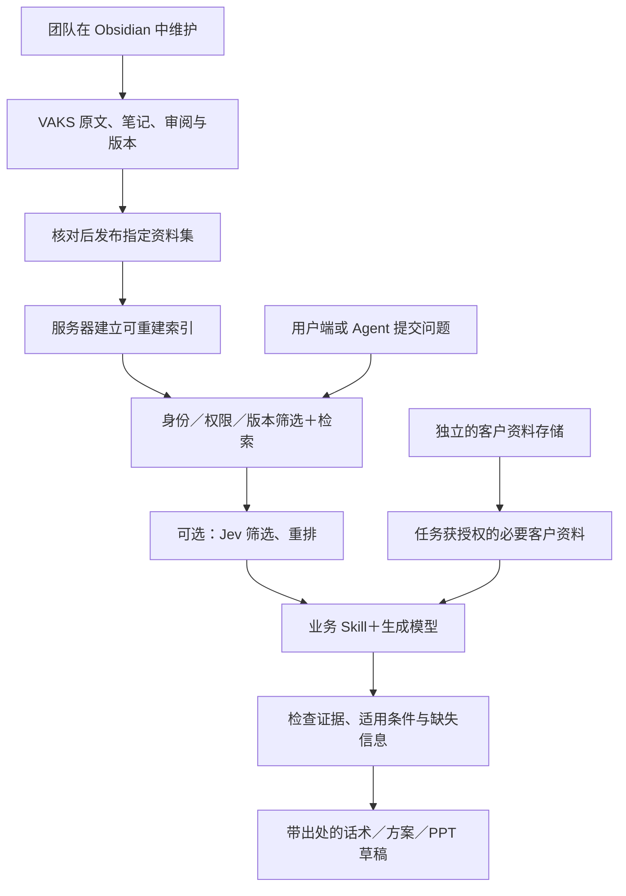

# 保有据（暂名）：香港保险代理人团队助手方案

> 本笔记保存用户表达的产品方向和助手提出的推进建议，供后续讨论与差距检查使用。它是候选方案，不是已验证架构、正式技术选型、保险建议、实施授权或上线结论。

来源：[[raw/articles/2026-09-26-vaks-insurance-team-direction-source|初版对话原话节选]]；[[raw/articles/2026-09-27-vaks-insurance-team-plan-update-source|架构补充与本次更新授权]]。

## 0. 产品暂名与定位

**建议暂名：保有据；香港界面写作「保有據」。** 本次由助手提出，尚未获得用户对这个具体名称的确认；文件原路径保持不变，方便既有链接继续使用。

| 项目 | 命名建议 |
|---|---|
| 简体产品暂名 | 保有据 |
| 香港繁体写法 | 保有據 |
| 产品说明 | 保险代理人的知识与方案助手 |
| 文案方向 | 让专业建议有据可查 |
| 内部知识底座名称 | VAKS（Verified Action Knowledge System） |
| 名称状态 | 工作暂名；商标、域名、应用商店名称与英文名待核验／拟定 |

命名考虑：“保”提示保险领域，“有据”表达来源可追溯的产品目标；三个字便于团队交流，也可覆盖资料查询、客户沟通和方案准备。文案表达产品目标，不构成所有输出均已核验或必然正确的承诺。

2026-09-27 仅做了普通网页初筛（「保有据」保险、「保有據」保險、「保有据」软件）。结果不足以判断名称权利或可注册性；没有完成正式商标、域名或应用商店核查。

备选仅保留讨论用途：**保知行**偏知识到实践，含义较宽；**保策**突出方案准备，但对知识与证据的表达较弱。备选未做同名核查。

## 1. 当前讨论方向

先服务本人及所在保险团队，用真实工作验证价值；长期可以考虑服务更多保险代理人。跨公司平台、苹果商店上架与商业规模扩张属于后续方向。

产品构想：**团队持续维护的专业资料＋经过案例打磨的业务 Skills＋用户私有客户情境，形成有依据的话术、比较说明和方案草稿。**

用户强调：话术 Skill 需要团队亲自打磨；产品资料由团队持续维护；用户提供自己的客户资料。助手建议下一步先完善 VAKS 到足够支撑第一个团队场景，而不是以实现全部通用规格作为前置条件。

这里的“确定性资料”指在明确来源、版本和适用条件下经过核验的资料；维护者身份、内部来源、用户认可或模型评分，都不会自动使结论成为真理。

## 2. 候选架构与职责

| 部分 | 候选职责 |
|---|---|
| Obsidian 内部工作台 | 团队阅读原文、整理笔记、审核资料和准备版本更新；普通用户通过产品或 Agent 使用服务 |
| VAKS 知识底座 | 保存来源、原文定位、审阅状态、版本、适用范围，以及重要冲突与缺项 |
| 发布资料集与索引 | 核对后发布指定业务资料及版本；服务器据此建立可重建索引 |
| 服务端检索接口 | 根据实际用户身份、可访问资料范围和版本查找相关内容 |
| 账号与客户应用数据 | 建议放在与共享知识逻辑分离的应用数据库／存储中，按用户及团队授权；部署位置待定 |
| 业务 Skills | 固定追问、分析、比较、引用、输出与失败处理的方法 |
| Agent | 理解请求、补齐必要信息、调用对应业务能力 |
| Jev（可选） | 辅助任务路由、候选片段筛选或相关性重排 |
| 生成模型 | 结合获授权的专业资料与客户情境生成草稿 |

此图描述拟议分工，不表示当前仓库已有这些生产服务。

### 服务器部署建议

保留 Obsidian 作为内部维护入口，服务器部署轻量知识服务。自行实现的重点是身份和权限、资料接口、核心 Skill 执行、版本引用与业务体验；存储、搜索、模型调用可以使用成熟组件。MCP 可作为同一服务的适配入口，具体框架与厂商尚未选定。

工作库与服务资料集分开：工作库可以包含草稿、候选研究和未完成修改；服务端只索引范围明确、获授权且适用的资料版本。一次编辑不等于一次发布，目录名也不能代替发布资格。

建议首版以明确的批次发布开始，记录资料版本、发布时间和引用定位；变更或撤回资料时同步处理索引、权限和旧缓存。紧急撤回可以先禁用对应资料，避免等待重新索引期间继续返回旧内容。这些是候选实现要求，当前未执行发布或同步服务。

Obsidian 的 Markdown 文件可由服务端程序直接读取。官方 Headless Sync 可以在没有桌面应用的服务器上同步库，但其作用是同步；用户权限、检索与业务执行仍由产品服务承担。它只是可选同步手段，尚未决定采用或购买。

## 3. 产品资产与数据边界

- 潜在产品资产包括：有权使用和提供的资料整理成果、事实与版本映射、比较方法、持续更新机制、业务 Skills 和经脱敏的质量评估案例。
- 公共资料并非天然独占；获得公司内部资料也不自动获得对外分发权。是否形成护城河，要看合法可持续的供给、结果质量、维护效率及实际用户价值。
- 团队专业资料与用户私有客户档案分开管理。客户资料按用户／团队隔离，只有当前任务必要且获授权的部分参与输出，不自动进入共享产品库。
- 知识资料保留原始 PDF／表格及证据定位，Markdown 用于知识记录与维护。索引或派生结构化字段保持来源关联；账号、客户档案和调用记录作为应用数据管理，不强制转成知识笔记。“逻辑分离”不要求首版购买多台服务器；客户存储与处理是否位于本地或云端仍待明确。
- 若需要保护核心 Skill，候选方式是服务端执行核心流程，外部 Agent 只获得调用入口及允许返回的结果。输出与返回片段仍对接收方可见，API 不保证资料绝不外泄或无法被逐步提取。
- 本地保存不等于本地处理。若调用 Jev 或其他云模型，被提交的内容会进入相应服务；模型选择、资料可处理范围和 BYOK 数据路径仍待确定。

## 4. Jev 的候选位置与性能假设

讨论中的 Jev 指 TypeSafe 的模型。其公开重排示例先用快速检索取得候选片段，再逐项评分与排序；不能据此把 Jev 当作完整资料库、权限系统或证据裁判。

- 替代原本由通用大模型完成的筛选，或减少后续生成所需上下文，可能节省时间和成本。
- 在原本简单的查询上增加一次云调用，也可能延长响应时间。
- 重排只能处理已被初次检索找到的候选；相关性高不代表条款真实、有效或适合具体客户。
- 当前没有本产品的端到端对照数据。建议后续比较不使用 Jev 与使用 Jev 的正确检索、引用支持、总耗时及成本，再决定是否保留。

因此，Jev 暂作为可替换优化候选，不作为 VAKS 团队版成立的前提。

## 5. 从企业知识助手借鉴的候选做法

公开文档展示了企业资料、用户权限、检索、任务上下文与生成分层的共同思路。Grok Bot 的可复用 Skill、Anthropic 的按需加载，以及下面的企业知识服务机制，可以作为设计参考。

| 公开来源 | 文档描述的机制 | 对本方案的启发（设计推断） |
|---|---|---|
| Microsoft 365 Copilot | 在当前用户权限范围内取得企业资料，补充上下文后交给模型 | 权限应在服务端检索链路执行 |
| AWS Bedrock Knowledge Bases | 资料发生新增、修改、删除后增量更新索引，查询时检索并生成 | 将资料处理与在线回答分开，明确旧内容更新与撤回 |
| Google Cloud RAG 参考架构 | 分开数据入库和在线服务，原始资料与检索索引各自保存 | 维护库、服务资料集、索引和应用服务职责分开 |
| Google 数据接入说明 | 支持文档以及结构化数据来源 | 文档知识与客户／产品结构化数据可以采用不同存储形态 |

后续可重点考察：资料与业务方法独立更新、检索前落实权限、结果展示出处和版本、资料更新后处理旧索引／缓存、Skill 更新后重看代表性案例、模型与重排器可替换。

这些资料是公开产品文档或供开发者使用的参考架构。上述启发不是现成采用结论，不声称厂商使用 Obsidian／VAKS／Jev，也不代表厂商认可本产品；它们不验证我们的保险准确性、延迟或商业效果。

## 6. VAKS 的完善顺序建议

### 下一项：团队试用能力差距检查（尚未开展）

建议形成一张 **保留／简化／补齐** 清单，逐项记录当前文件或代码证据、缺口和最小处理方式。先检查来源与版本、原文定位、候选和已审阅内容的区分、发布资料集、实际检索入口、账户权限、客户数据隔离及结果引用。

保留通用 VAKS 骨架，用保险业务作为第一个应用来检验它。差距检查本身不代表进入编码、部署或模型调用。

### 随后：小批资料＋一个业务闭环

1. 选一小批团队真实使用、允许处理的资料，整理来源、版本、生效时间、适用范围和原文位置。
2. 候选首个 Skill 是“客户对话分析＋有出处的回复草稿”。检查需求、追问缺项、取得资料、生成草稿，再由有经验的同事判断是否可用。
3. 在后续明确启动试用／验证时，使用脱敏的代表性案例同时观察质量和耗时；本次入库不执行这些验证。
4. 根据实际缺口补最小服务层，再考虑扩充产品比较、PPT、录音转录及更多入口。

### 建议的试用检查点（未达成声明）

- 重要结论能定位到具体原文和版本。
- 编辑中的草稿不会直接出现在团队服务资料集中；服务端可说明当前采用的资料版本。
- 资料更新后能识别被替代内容，避免继续当成当前依据。
- 用户只能取得自己有权访问的资料和客户记录。
- 候选资料与已核验内容不会混用为具有同等证据效力的知识。
- 缺少依据或客户信息时能追问、缩小回答范围或留下待核对项。
- 资料维护工作量可以承受，查询等待时间满足团队实际使用要求。

资料收录、整理、重要事实审核和索引更新，可以安排在资料进入／变更时完成。每次查询仍需保留权限、版本和适用性检查；客户产品建议等重要用途还需检查证据是否充分。

## 7. 目前能力与未定事项

对话中的只读检查表明：当前 VAKS 有知识规范、本地来源保存工具、只读 Guard 和实验代码；完整可部署知识 API、真实权限集成及生产端到端性能尚未被该检查证明。不能把 sandbox 的本地耗时当作线上问答速度。

待继续确认：

- 首批资料覆盖哪些产品、版本和用户角色，以及维护负责人是谁。
- 原始内部资料可使用、转交云模型及对用户提供的范围。
- 客户资料保存位置、必要字段提取方式、结果生成位置和删除机制。
- 首个业务 Skill 的具体输入、输出与团队认可的质量标准。
- Jev 对该资料集是否有实际收益；先选择什么生成模型与检索方式。
- 产品资料和 Skills 是否足以形成可持续的付费价值。
- 用户是否认可暂名“保有据／保有據”，以及最终英文名和名称可用性。
- 资料发布及撤回由谁负责，如何发现同步／索引更新失败，何时需要网页管理后台。

后续候选能力：产品比较与方案、PPT 模板、产品内录音转录、聊天记录导入。BYOK、跨公司平台和 App 上架尚未排期；“任意平台聊天接入”不视为已实现。直接调用 ASR 可减少对其他录音 App 的依赖，但云 ASR 仍属于外部处理；转录内容应允许核对。

## 8. 恢复阅读入口

本项目代码目录：`C:\Users\Administrator\Documents\资料库`；正式笔记库：`H:\Obsidian\资料库`。以下是此前检查的定位入口，后续工作应重新核对当前状态；本次不复制或改写这些架构文档。

- `README.md`：日常保持轻量、关键判断才加强证据检查。
- `FUSION_ARCHITECTURE_V0_2_DRAFT.md`：普通查询边界、证据充分性与时效适用性。
- `IMPLEMENTATION_BLUEPRINT.md`：普通查询路径、资料维护职责及服务接口规划。
- `00_handoff/2026-06-22-vaks-guard-closeout-and-bases-park-handoff.md`：Guard 与 parked 能力的当时边界。
- `tools/vaks_supervised_trial_adapter_r1_5.py`：实验明确未证明真实检索、真实模型质量和生产延迟。

## 9. 对话中查阅的官方参考

以下链接供后续回查；本次保存的是讨论方案，没有新增网页快照或完成独立证据审阅。厂商文档更新后需重新核对。

- [Grok Bot：Skills and routines](https://docs.x.ai/grok-bot/skills-routines-and-automations)
- [Anthropic：Agent Skills 的组织与按需加载](https://www.anthropic.com/engineering/equipping-agents-for-the-real-world-with-agent-skills)
- [Microsoft 365 Copilot：架构与权限内资料使用](https://learn.microsoft.com/en-us/microsoft-365/copilot/microsoft-365-copilot-architecture)
- [AWS Bedrock：资料增量同步与重新索引](https://docs.aws.amazon.com/bedrock/latest/userguide/kb-data-source-sync-ingest.html)
- [AWS Bedrock：检索与生成](https://docs.aws.amazon.com/bedrock/latest/userguide/kb-how-retrieval.html)
- [AWS Bedrock：重排](https://docs.aws.amazon.com/bedrock/latest/userguide/rerank.html)
- [Google Cloud：RAG 参考架构](https://docs.cloud.google.com/architecture/gen-ai-rag-vertex-ai-vector-search)
- [Google Cloud：文档与结构化数据准备](https://docs.cloud.google.com/generative-ai-app-builder/docs/prepare-data)
- [Obsidian：知识文件的保存方式](https://help.obsidian.md/Files+and+folders/How+Obsidian+stores+data)
- [Obsidian：Headless Sync](https://help.obsidian.md/sync/headless)
- [TypeSafe：Jev 重排示例](https://docs.typesafe.ai/cookbooks/rerank_typesafe)
- [TypeSafe：API 接入方式](https://docs.typesafe.ai/introduction/quickstart)

## 10. 方案修订记录

- **2026-09-26 / 初版**：保存团队版方向、VAKS／Skills／Jev 分工、资料边界与完善顺序。
- **2026-09-27 / draft-2**：拟定“保有据／保有據”为待确认暂名；补充 Obsidian 维护、审核后发布、独立服务层、客户应用数据分离和企业官方参考。保留原文件路径及候选身份；没有把方案更新解释为技术选型或开发授权。

## 本次保存范围

更新同一份候选方案并新增本次对话来源记录，保留初版原话记录。没有创建 Source Annotation、Project Overlay、正式决策、reviewed knowledge 或行动依据；没有修改主架构、运行测试／基准、调用模型、部署服务、提交或推送代码。
