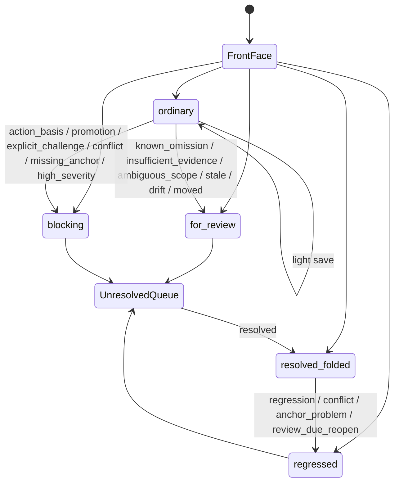
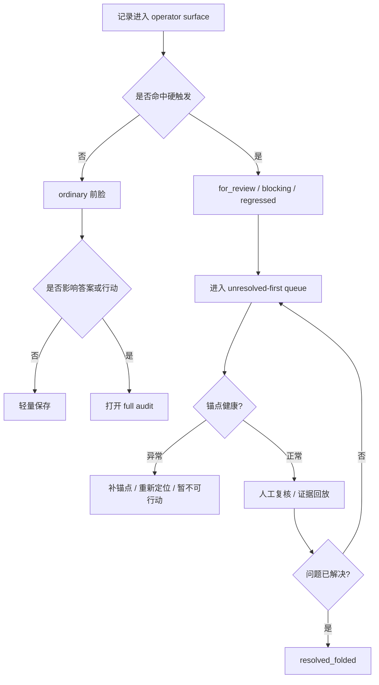

# Audit shell v1 state and slot convention

## Status

This is a sandbox convention note. It does not change `SCHEMA.md`, the truth ledger, or main-vault operation rules.

The purpose is to make the audit shell v1 core explicit:

```text
state machine + operator front-face slots
```

The card is only a renderer. It is not the architecture center, not a truth layer, and not an end-user default UI.

## Core State Machine



## State Meanings

| State | Operator meaning | Rule |
|---|---|---|
| `ordinary` | 普通记录，轻量保存 | Keep light unless it becomes action basis or hits a hard trigger. |
| `for_review` | 需要复核 | Route to unresolved queue; do not treat as action-ready. |
| `blocking` | 阻塞，暂不可行动 | Open full audit; fix anchor/conflict/action-basis problem first. |
| `resolved_folded` | 已解决，默认折叠 | Keep out of default unresolved surface unless reopened. |
| `regressed` | 已回归，重新入队 | Reopen and route to unresolved queue. |

## Required Operator Front-Face Slots

The invariant is slot coverage, not a fixed six-line card. Six lines can be a display budget, but it is not a proof of quality.

| Slot | Required content | Rule |
|---|---|---|
| 状态 | ordinary / for_review / blocking / regressed / resolved_folded 的人话状态 | Do not expose raw machine labels as the primary wording. |
| 一句话摘要 | The current record's own summary | Must not be overwritten by exemplar or grouped summary. |
| 风险原因 | Why it remains light, or why it escalates | Must name hard trigger or anchor problem when present. |
| 锚点状态 | 可回源 / 缺失 / 过期 / 漂移 / 移位 | Anchor problems must be directly visible. |
| 处理建议 | 轻量保存 / 需要复核 / 打开 full audit / 补锚点 / 暂不可行动 / 默认折叠 | Must be actionable for Codex / Pro / reviewer operator. |
| 定向边界提醒 | Only when authority bait, count, lineage, recurrence, or feedback is relevant | Do not flood every ordinary record with global disclaimers. |
| Drilldown handles | 来源 / 记录 / 证据 / 原文片段 | May be collapsed, but must be source-first and recoverable. |

## Guardrails

- `shell_core` is the default controller/surface core.
- Chinese operator rendering is required for operator use, but remains a renderer.
- Recurrence and grouping stay default-off side arms.
- Authority lint, categorical feedback strip, and forbidden wording lint stay background guardrails.
- Dashboard, test pass, source count, group count, lineage, feedback, LLM summary, and lint pass must never be rendered as truth authority.
- `claim_relevant_context_landing` is weaker than evidence landing and must not be treated as evidence support.

## Current Package Interpretation

The latest package supports this convention as a direction:

- Codex local self-test over 26 local real/full-anchor samples found the operator surface usable for Codex triage.
- This is not human adjudication and not a product click-back gate.
- The package remains `not_go_yet`.

## Operator Handling Flow



## Candidate Convention Now

These parts are clear enough to keep as sandbox candidate convention because
they are view/escalation rules and do not mutate the truth core.

| Can land now | Why |
|---|---|
| hard-trigger list | Directly protects against serious false-lite. |
| unresolved-first + resolved folding | Matches mature review / issue triage systems and keeps attention on open items. |
| state wording mapping | Reduces operator misunderstanding of machine labels. |
| sparse pointer minimum | Preserves jump-back without flooding the front face. |
| Chinese operator wording + forbidden wording | Reduces authority leakage in the operator surface. |
| `claim_relevant_context_landing` / `claim_landing` / `evidence_landing` distinction | Prevents transport or claim-context landing from being overclaimed as evidence landing. |
| feedback only affects queue / applicability, not truth | Must be fixed as a boundary rule. |

## Parked For Future Runtime

These parts should stay parked because they depend on runtime extraction,
traffic volume, UI observation, or stronger product evidence.

| Parked | Why |
|---|---|
| messy-log automatic fingerprint extraction | Current recurrence still relies on favorable structured fields. |
| dynamic recurrence digest optimization | Needs real traffic and operator misunderstanding data. |
| semantic selector scoring / auto landing confidence | High risk of fake precision and authority leakage. |
| tail-style trace retention policy | Needs real query/run volume and cost model. |
| full reviewer cockpit | Correct long-term direction, but not needed for v1 minimum. |
