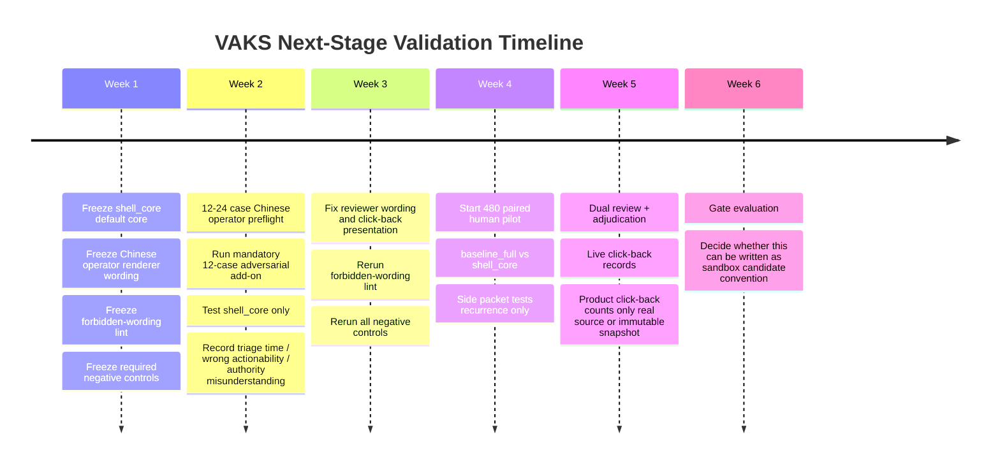

# Negative Controls And Validation Timeline

Status: sandbox-only validation plan and automated harness self-check. No main-vault writeback, no `SCHEMA.md` change, and no operation-convention promotion.

## Why Negative Controls Matter

The shell cannot be trusted only because `shell_core` looks clean. The harness
must also catch intentionally bad renderers. If a negative control is not
caught, the current automated scaffold is not credible enough to support the
next validation stage.

Minimum rule:

```text
all negative controls must fail
```

## Required Negative Controls

| negative control | intentional break | must be caught by | why it matters |
| --- | --- | --- | --- |
| `leaky_or_unversioned_control` | Removes hard-trigger shell behavior and uses unversioned grouping. | state mismatch, serious false-lite, serious folded, over-grouping, authority leakage | Proves the harness catches missing escalation and bad grouping. |
| `authority_leaky_renderer` | Deliberately writes authority wording such as dashboard/test pass implying truth. | authority leakage lint / forbidden wording | Proves the harness catches obvious authority leakage in rendered text. |
| `fake_precision_feedback_renderer` | Deliberately emits numeric confidence-style wording such as risk / feedback delta / confidence percent. | fake-precision authority leakage lint | Proves the harness catches diagnostic numbers being framed as truth or actionability. |

These controls are not candidate designs. They are intentionally broken arms.
Their only acceptable outcome is failure.

## Latest Automated Readout

After adding the two new negative renderers and rerunning the 800-case checks:

| variant | safety pass | authority leakage | serious false-lite | serious folded | severe over-grouping | expected |
| --- | ---: | ---: | ---: | ---: | ---: | --- |
| `shell_core` | true | 0 | 0 | 0 | 0 | candidate remains clean on automated gates |
| `shell_core_plus_recurrence` | true | 0 | 0 | 0 | 0 | side arm remains automated-gate clean, still not default core |
| `leaky_or_unversioned_control` | false | 48 | 376 | 12 | 12 | negative control correctly fails |
| `authority_leaky_renderer` | false | 692 | 0 | 0 | 0 | negative control correctly fails |
| `fake_precision_feedback_renderer` | false | 692 | 0 | 0 | 0 | negative control correctly fails |

Interpretation:

- `shell_core` remains the only default-core candidate.
- `shell_core_plus_recurrence` remains a conditional side arm.
- The three negative controls are caught, so the harness remains useful as an
  automated scaffold.
- This still does not prove product-grade auditability, click-back usability,
  independent human oracle quality, or semantic safety.

## Six-Week Validation Timeline



## Gate Discipline

Do not promote the shell based on:

- line reduction
- front-line budget
- dashboard green
- test pass
- lint pass alone
- source count
- group count
- lineage completeness
- LLM summary fluency
- feedback delta
- fake numeric confidence

The product-grade gates remain:

- serious false-lite
- ordinary false-positive
- review_due precision and recall
- source / record / evidence click-back success
- wrong actionability
- authority misunderstanding
- human triage time
- full-audit open rate
- over-grouping rate in the recurrence side packet

Truth source for those gates must be reviewer/adjudicator judgment and real
click-back/timing logs, not overlay replay or renderer self-checks.

The full go / no-go table and current `not_go_yet` evaluation live in:

```text
reports/QUALITY_GATES_AND_THRESHOLDS.md
quality_gates_v1.json
quality_gate_eval_800.json
```
